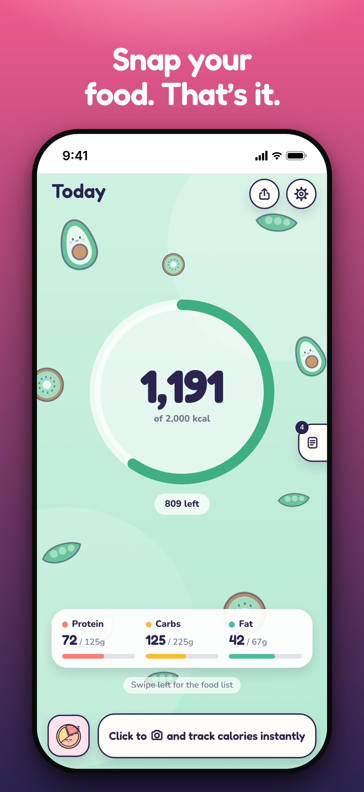
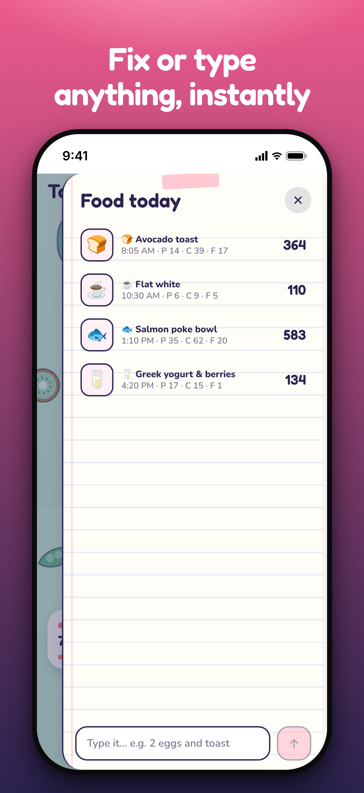
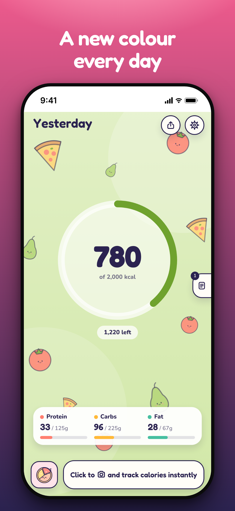
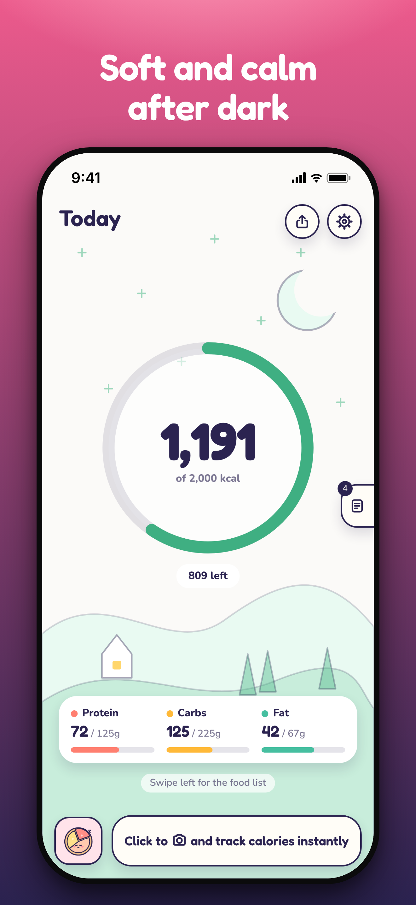

# Real Quick – The Fastest Calorie Tracker

Snap your food. That's it. One button takes a photo from an always-ready
mini camera; an AI vision model counts calories and macros while you eat.

- **app/** — Expo (SDK 57) app for iOS and Android, with iOS Lock Screen /
  Home Screen widgets and an iOS 18 control, and Android home-screen widgets.
- **server/** — the model gateway (Python) that holds the API key and prompt.
- **marketing/** — brand, store listings (en + ja), privacy, site, screenshots.
- **HANDOFF.md** — the remaining owner-only steps.
- **CLAUDE.md** — how the project is built and where it deviates from the
  house blueprint.

